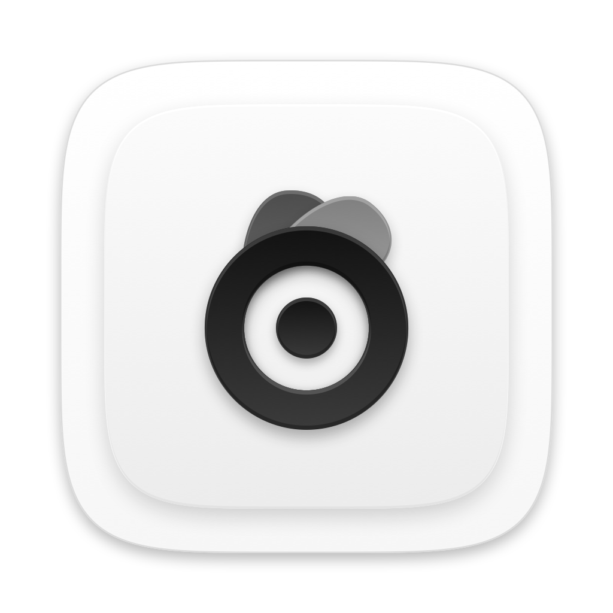

<p align="center">
  
</p>

<h1 align="center">Guarana</h1>

<p align="center">
  <a href="https://github.com/manorajesh/guarana/actions/workflows/build.yml"></a>
  <a href="https://github.com/manorajesh/guarana/releases/latest"></a>
  <a href="https://github.com/manorajesh/guarana/releases"></a>
  
  
  <a href="LICENSE"></a>
</p>

<p align="center">A tiny macOS menu bar app for toggling <code>caffeinate -d</code>.</p>

Click the guarana icon to keep it awake.

Right-click or Control-click the menu bar icon for uptime, `Keep Display On`, `Turn On` / `Turn Off`, and `Quit`.

`Keep Display On` is enabled by default. When disabled, Guarana still keeps the Mac awake from idle sleep, but it does not pass `-d` to force the display to stay on.

## Install

Download `Guarana-<version>.zip` from the [latest release](https://github.com/manorajesh/guarana/releases/latest), unzip it, and move `Guarana.app` to `/Applications`. It is a universal binary (Apple silicon and Intel).

If the release isn't notarized, macOS will block the first launch. Open it once, then go to **System Settings → Privacy & Security** and click **Open Anyway**, or clear the quarantine flag:

```sh
xattr -dr com.apple.quarantine /Applications/Guarana.app
```

## Build

Requirements:

- macOS
- Xcode command line tools

```sh
make
```

The app bundle is created at:

```text
build/Guarana.app
```

Run it with:

```sh
make run
```

To install it for regular use, copy the built app into `/Applications`:

```sh
cp -R build/Guarana.app /Applications/
```

Other targets:

- `make dist` signs the app (ad-hoc by default, or `CODESIGN_IDENTITY="Developer ID Application: …"`) and zips it to `build/Guarana.zip`.
- `make icon` regenerates `Resources/AppIcon.icns` and `Resources/AppIcon.png` from `scripts/generate-icon.swift`, which draws the same guarana berry as the menu bar icon.

## Releases

Pushing a `v*` tag (for example `git tag v1.1 && git push origin v1.1`) runs the [Build workflow](.github/workflows/build.yml), which builds a universal app, stamps the version from the tag, and publishes the zip to GitHub Releases.

Signing and notarization run automatically when these repository secrets are set; without them the release is ad-hoc signed:

| Secret | Value |
| --- | --- |
| `MACOS_CERTIFICATE` | Base64-encoded Developer ID Application `.p12` (`base64 -i cert.p12 \| pbcopy`) |
| `MACOS_CERTIFICATE_PASSWORD` | Password for the `.p12` |
| `APPLE_ID` | Apple ID email of the developer account |
| `APPLE_TEAM_ID` | 10-character team ID |
| `APPLE_APP_SPECIFIC_PASSWORD` | App-specific password from account.apple.com |

## Process Cleanup

When enabled, the app runs:

```sh
/usr/bin/caffeinate -d -w <app-pid>
```

If `Keep Display On` is unchecked, it runs:

```sh
/usr/bin/caffeinate -w <app-pid>
```

The `-w` option makes `caffeinate` release its assertion and exit when the app process exits. The app also terminates its child process when toggled off, when quitting normally, and when receiving `SIGINT`, `SIGTERM`, or `SIGHUP`.

## Why Guarana?

I like the drink Guaraná Antarctica. The guarana berry is native to the Amazon basin and contains caffeine, keeping you (and the Mac) awake. The app's icon is a stylized guarana berry from [Lívia Zambolim](https://www.behance.net/gallery/108504977/Redesign-de-logo-Guarana-Antarctica?tracking_source=search_projects_recommended%7Cguarana).